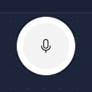
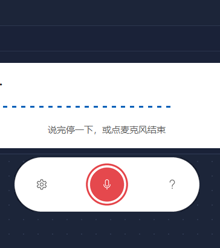
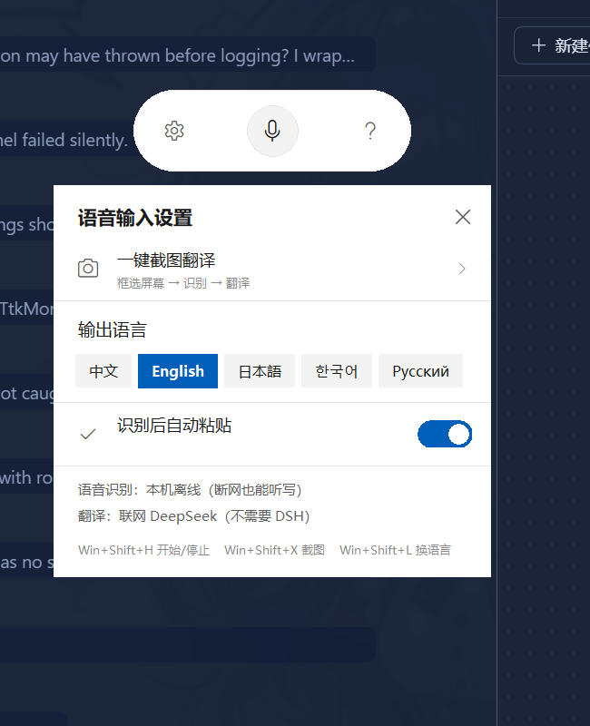
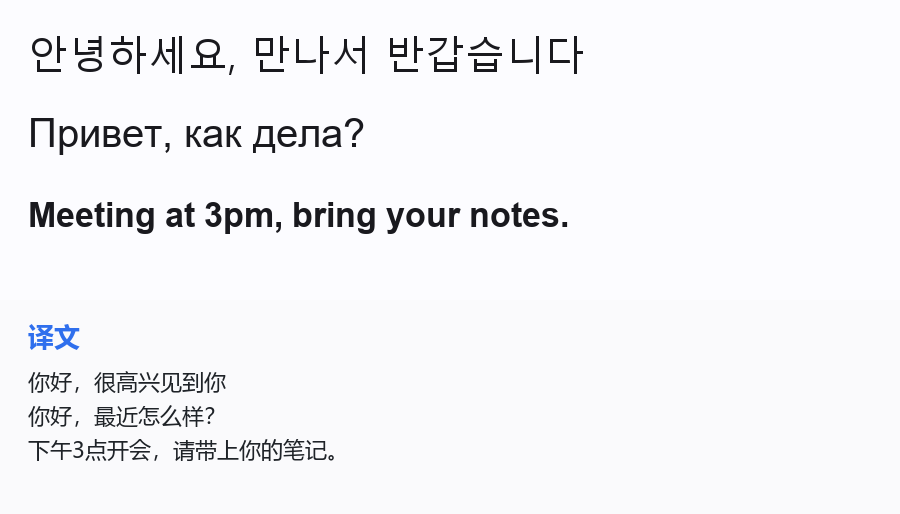

# 肥鱼输入器 · FatFish Input

> Windows 上**随时可用的语音输入 + 截图翻译**小工具。
> 常驻一个小麦克风，按热键说话就出字；框一块屏幕就把里面的外文翻成中文。
> **不依赖任何宿主程序**（不需要 VS Code / Electron / 任何 AI 客户端开着）。



---

## 它能干什么

| 功能 | 怎么用 | 说明 |
|---|---|---|
| **语音输入** | `Win+Shift+H` 说话，停一下自动结束 | 本地识别（sherpa-onnx Paraformer，断网也能用）→ 可选翻译 → 自动粘贴到你刚才所在的窗口 |
| **翻译输出** | 点胶囊上的语言块，或 `Win+Shift+L` | 中文 / English / 日本語 / 한국어 / Русский |
| **截图翻译** | `Win+Shift+X` 拖框选区 | 识别图中任意语言文字 → 翻成目标语言 → 结果卡 + 一张"原文/译文对照图"另存 |
| **常驻 / 收起** | 闲置 6 秒自动缩成小圆钮 | 点圆钮展开并开始录音；右键可收起/展开/隐藏/退出 |
| **不打扰** | 全部浮窗 `WS_EX_NOACTIVATE` | 不抢焦点，打游戏/打字时不打断你 |





截图翻译出来的对照图（上原文、下译文）：



---

## 安装

**要求**：Windows 10/11、Python 3.10+（装的时候勾上 `Add Python to PATH`）、能上网。

```powershell
git clone <本仓库地址>
cd fatfish-input
powershell -ExecutionPolicy Bypass -File .\install.ps1
```

安装脚本会做四件事：

1. `pip install` 依赖（sounddevice / numpy / pystray / pillow / sherpa-onnx）
2. 下载中文语音识别模型（约 232MB，国内走 hf-mirror）
3. 问你要一个 **DeepSeek API Key**（`sk-...`，翻译用；不想填可以以后在 `config.json` 里补）
4. 建开机自启快捷方式并立刻启动

> 不想用脚本，也可以手动：装依赖 → 把模型放到 `models/asr-paraformer-zh/` → 双击 `start.vbs`。

### 卸载

```powershell
powershell -ExecutionPolicy Bypass -File .\uninstall.ps1            # 只停用
powershell -ExecutionPolicy Bypass -File .\uninstall.ps1 -PurgeModels  # 连 232MB 模型一起删
```

---

## 使用

| 热键 | 动作 |
|---|---|
| `Win+Shift+H` | 开始 / 结束语音输入 |
| `Win+Shift+X` | 截图翻译（拖框选区，Esc 取消） |
| `Win+Shift+L` | 循环切换输出语言 |

- **点麦克风**：点一下开始，再点一下结束；说完停顿约 0.7 秒也会自动结束
- **右键胶囊**：设置 / 截图翻译 / 收起 / 展开 / 隐藏 / 退出
- **设置面板**（⚙）：
  - 一键截图翻译
  - 输出语言（5 种）
  - 翻译引擎（自动 / 在线 / 离线）
  - 识别后自动粘贴（关掉就只复制到剪贴板）

---

## 配置 `config.json`

| 键 | 默认 | 说明 |
|---|---|---|
| `hotkey_voice` / `hotkey_shot` / `hotkey_lang` | `Win+Shift+H/X/L` | 全局热键（`Win` / `Shift` / `Ctrl` / `Alt` + 单字母） |
| `target_lang` | `中文` | 输出语言 |
| `api_key` | 空 | DeepSeek API Key；也可用环境变量 `DEEPSEEK_API_KEY` |
| `api_model` | `deepseek-flash` | 翻译模型 |
| `silence_ms` | 700 | 说完多久算结束 |
| `auto_paste` | true | 识别完是否自动粘贴 |
| `mt_engine` | `online` | `online` 走 DeepSeek；`offline` 走本地模型（需自行准备） |
| `bar_x` / `bar_y` | -1 | 胶囊位置（拖动自动保存；-1 = 屏幕下方居中） |

---

## 它是怎么做的

- **语音识别**：`sherpa-onnx` + Paraformer-zh（int8 ONNX，CPU 约 0.3 秒/句），完全本地
- **翻译**：DeepSeek `chat/completions`，**关闭推理**（`thinking: disabled`）后 1500 token 够用、单句约 0.8 秒；连接复用省掉 TLS 握手
- **截图识别**：截图 → 缩放 → 直接作为图像消息交给视觉模型（任意语言）
- **全局热键**：`RegisterHotKey` + 独立消息循环，不依赖任何窗口焦点
- **界面**：Tk 画布 + PIL **4 倍超采样**渲染（Tk 的圆角和圆形不做抗锯齿，只能自己在高分辨率下画完再缩）
- **清晰度**：进程启动先声明 Per-Monitor V2 DPI 感知，否则 150% 缩放屏上整窗会被位图拉伸变糊
- **独立进程**：`pythonw` + WMI 拉起（不在任何 Job Object 里），宿主退出不会带走它；启动时若发现自己在 Job 里会自我脱离重启

---

## 常见问题

**按热键没反应？**
可能和别的软件抢了热键。看 `fatfish_input.log` 里有没有 `-> FAILED`，改 `config.json` 的 `hotkey_*` 换一个组合。

**说话没识别出字？**
看日志 `voice ...` 行。第一次说话要等 1~2 秒加载模型；麦克风权限/默认设备也检查一下。

**粘贴没反应？**
很多游戏/管理员权限窗口不接受模拟粘贴。关掉「识别后自动粘贴」后，结果会复制到剪贴板，手动 `Ctrl+V` 即可。

**翻译报错？**
检查 `api_key` 是否有效、余额是否够（DeepSeek 控制台）。语音识别本身不需要网络。

**真的能离线吗？**
能——**语音识别完全离线**。翻译需要网络（走 DeepSeek）。想要离线翻译可以自己放一个本地模型并把 `mt_engine` 设成 `offline`。

**关掉其他程序还能用吗？**
能。它是独立进程 + 开机自启，跟任何编辑器/AI 客户端无关。

---

## 已知限制

- 真·独占全屏的游戏里浮窗可能盖不上去 → 用「无边框窗口」模式即可
- 只支持 Windows（用的是 Win32 热键/剪贴板/DPI 接口）
- 语音识别模型是中文（Paraformer-zh），说英文/日文识别率一般

## License

MIT
